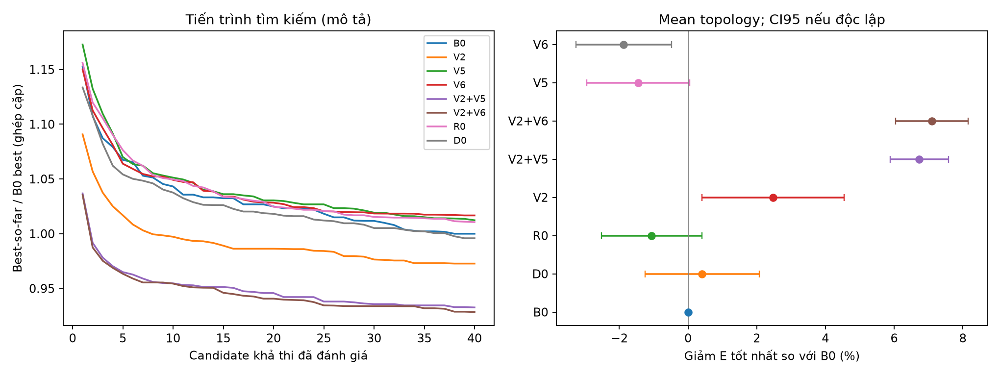
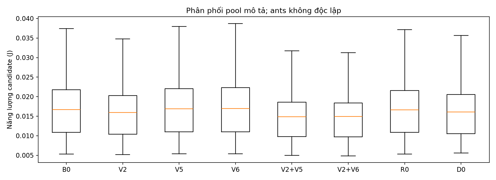
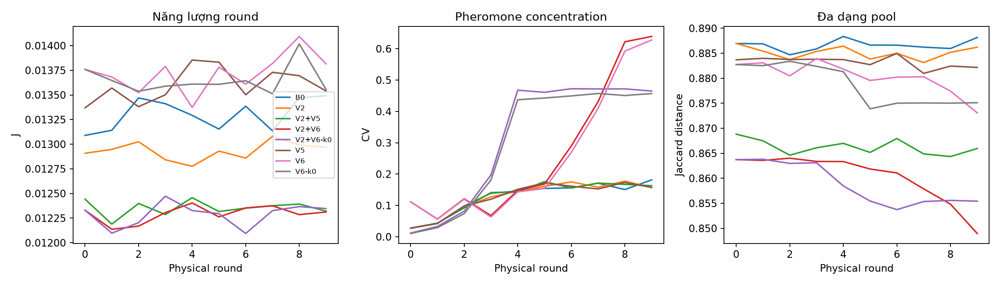

# Cải thiện candidate construction AC-ACO: kết quả nghiên cứu có kiểm soát

Ngày 14/10/2026, Windows, Asia/Bangkok. [Thiết kế toán học](design.md), [review cuối](code-review.md), [thống kê holdout](holdout/analysis/statistics.json), [dữ liệu bổ sung](final-analysis/details.json).

## 1. Trả lời câu hỏi nghiên cứu

**Có bằng chứng cải thiện candidate pool bằng marginal-energy construction; các combination có direct disturbance thấp hoặc bằng 0 cho kết quả tốt hơn.** Trên holdout với 18 topology độc lập và algorithm seeds 74–75, có 17 topology/33 điều kiện seed đạt pool40 ở cả hai phía: V2 giảm năng lượng tốt nhất **2,474%**; V2+V5 giảm **6,730%**; V2+V6 giảm **7,094%**, so với B0. Hai combinations cải thiện ở cả 17 topology đủ điều kiện.

**Chưa chứng minh chaotic evaporation giúp giữ thông tin hữu ích.** Gain first-round của V2+V6 không do evaporation: cập nhật rho chỉ xảy ra sau khi pool đã được tạo. Đối chứng κ=0 trên trajectory10 rounds không cho lợi ích trung bình của κ=.5. Progress-adaptive chaos có tín hiệu tốt khi kết hợp proxy, nhưng chưa tách được lợi ích feedback khỏi lợi ích giảm mức randomness. Không có kết luận lifetime.

## 2. Baseline và trạng thái nguồn

- `before.json` lưu git HEAD/status và SHA-256 của 48 file có sẵn: source, tests và map. **0/48 file này bị thay đổi** trong công việc này. Các sửa đổi chưa commit của người dùng được giữ nguyên.
- Current default đã lệch audit: `load_weight=.25`, `tau_min=1`; wrapper đang chọn normalized energy+CV khi load_weight>0. File powered fitness/FitnessReferences có sẵn nhưng không được wrapper AC import. Không đưa cơ chế này vào nghiên cứu energy-only.
- B0 là cấu hình **audited-original energy-only**, explicit `load_weight=0,tau_min=.01,tau0=1`, các tham số khác giữ audit/current tương thích. Production defaults không bị đổi. `ResearchACACO(options=None)` tái lập đúng current production behavior; CLI nghiên cứu chủ động chọn audited parameters và ghi đầy đủ.
- Map audit khớp SHA-256 `f5e6ebb66f9f361f5d91cceda44dff85e7eca4d1dc86877a74ab81a6216f1af8`, nhưng thực tế **uniform seed41**, không clustered. N100, cube500m, radius200m, energy.6J, sink(250,250,0). Không thay/ghi lại map. Clustered được sinh riêng trong thư mục campaign.
- Không sửa D-ACO, SimpleACO, PSO, shared builder/router/evaluator/simulator, generator hoặc CSV lịch sử. Không đổi mục tiêu cuối `min E_total` của các AC variants.

Source/config/environment/map hashes được ghi trong từng `metadata.json`; proxy validation có provenance riêng. Development, holdout và final source snapshots khác nhau ở sửa edge cases, validation, telemetry và bỏ khởi tạo cache clustering hai lần. Không thay công thức sampling/objective trong các sửa cuối. Diagnostic rerun xác nhận **15/15** điều kiện B0/V1-0/V2 trùng chính xác toàn bộ CH sequence, energy và consumption với development đã lưu; rerun V2+V6 trùng60/60 physical-round observations. Đây là kiểm chứng tái lập, không phải deployments độc lập bổ sung.

## 3. Toán học và cơ chế được kiểm tra

Mapping 10 functions, physics và phương trình baseline đầy đủ ở [design.md](design.md). Các điểm quyết định:

1. Baseline chọn `k=min(N_live,max(1,round(.2*N_live)))`, start uniform, pairwise pheromone và transition `tau^alpha*(residual/d^omega)^beta*E_m(d)^(-gamma)`. Với mặc định raw schedule, beta=1 ở các round ngắn; T_max vẫn3500.
2. Consecutive CH trong construction không định nghĩa routing edge. Trong diagnostic audited-map5 seeds, chỉ **2,42%** consecutive pairs B0 là cạnh thật của cây (không xét hướng); V2 là1,84%. Khoảng98% transition distances không phải khoảng cách TX tương ứng. Điều này hỗ trợ nhận định surrogate không khớp objective; không chứng minh distance bias luôn có hại.
3. Physical distance vẫn ở TX acoustic, nearest-CH assignment, radius constraints và greedy multi-hop router. CH thực tế gửi **2 packet-equivalents**; RX tính mọi packet nhận; DA của CH tính theo packet nhận. Không đổi các quy tắc đó.
4. V1 chỉ giảm explicit exponent omega. Ngay omega=0, `E_m(d)^(-gamma)` vẫn ưu tiên khoảng cách giữa các CH. Không gọi V1 là loại hết distance influence.

### Proxy partial solution V2

Trên graph live nodes, cạnh phải trong radius và giảm khoảng cách tới sink, cache `g_i`: shortest incremental cost của một packet tới sink. Cạnh sensor→sensor tính TX+RX tại receiver; cạnh cuối tới base chỉ TX. Proxy bỏ qua role/compression/blocking và lựa chọn greedy thực tế. Node không reachable có fallback hữu hạn `(N_live+1)*(TX(radius)+RX+DA)`; không dùng fallback làm chứng nhận route khả thi.

Với S là CH set, M(S) là members có nearest CH trong radius, U(S) là outliers:

\[
\widehat E(S)=\sum_{i\in M(S)}[TX(d_{i,nearest(S)})+RX+DA]
+2\sum_{j\in S}g_j+\sum_{i\in U(S)}g_i.
\]

S rỗng: `Ehat(empty)=sum(g_i)`. CH được loại khỏi member sum, tránh tính packet riêng hai lần. Các phần downstream relay-own traffic đã có trong term riêng của node; incremental path charge chỉ thêm lưu lượng tương ứng. Relay sharing, compression tại intermediate CH, DA của packets CH nhận từ backbone và member dropping vẫn gây sai số. Proxy không phải upper/lower bound và không gọi Evaluator trên cây partial.

\[
\Delta_j=\widehat E(S\cup\{j\})-\widehat E(S),\quad
s=\max(median_j|\Delta_j|,\epsilon E_{scale}),\quad
H_j=\exp(clip(-\Delta_j/s,-40,40)).
\]

P tỷ lệ `tau_ij^alpha*H_j^beta`, rồi áp dụng chaos policy riêng. H dương, hữu hạn, monotone không tăng theo delta; chấp nhận cả marginal âm/dương/0 và đồng biến scale energy. **First CH vẫn uniform**; proxy empty được định nghĩa/kiểm thử nhưng không điều khiển start. Deposit vẫn Q/final energy trên ordered construction edges. Vì vậy kết quả chứng minh marginal-guided construction, chưa chứng minh pheromone credit đã được căn chỉnh theo marginal gain.

Cache/init O(N²), mỗi transition O(N*|A|), mỗi ant khoảng O(kN²). Không router/evaluator call cho từng candidate addition; số proxy cell operations và thời gian được ghi riêng. Full-tree evaluations vẫn40 cho pool đầy đủ. Đây là equal full-evaluation budget, **không phải equal CPU budget**.

### Chaos policies

- Legacy: `p'=(p+c)/(1+n*c)` tương đương uniform mixture với λ=`n*c/(1+n*c)`. Trên audited-map, meanλ≈.725; N100/source0 ở transition đầu λ≈.806. N tăng tự làm uniform share lớn.
- V3: direct disturbance c nhân .1; giữ additive pheromone disturbance để cô lập selection change. V4: λ=`strength*x_source`, không phụ thuộc cardinality.
- V5: sau mỗi feasible candidate, quan sát relative best improvement q, EMA=.8EMA+.2q, stagnation h. `b=.02+(.25-.02)*(1-EMA)*(1-cos(2*pi*(h mod8)/8))/2`; actual λ=`b*x_source`. Reset feedback mỗi physical round; update sau evaluation/deposit, trước ant tiếp. Không dùng future evidence hoặc trừ residual trong search. Pulse không mắc ở maximum; feedback có thể yếu nếu q rất nhỏ, nên chưa kết luận adaptive law vượt fixed low exploration.
- V6: per-source `rho_eff=clip(rho_base*(1-.5*x_source),rho_min,rho_max)`. End-round `tau_mid=clip((1-rho_eff)*(tau+ant_deposits),tau_min,tau_max)`, rồi ordinary elite deposit. Không direct probability noise, không additive chaotic tau disturbance. Logistic mỗi live source tiến một lần sau update. κ=0 giữ cùng selection/update structure nhưng rho_base, dùng làm causal control. Khi rho_base về rho_min, clipping triệt tác dụng giảm evaporation.

## 4. Protocol và thống kê

| Giai đoạn | Topology | Algorithm seeds | Số observations | Full-tree evaluations |
|---|---|---|---:|---:|
| Audited first round | uniform100/41 | 24–33 | 140 pools | 6000 |
| Development grid | clustered/uniform/normal × N50/100/200 × seed51/52 | 24–26 | 810 pools | 33484 |
| Holdout | 18 maps, scenario seeds11–28 mỗi map riêng | 74–75 | 324 pools | 14260 |
| Short physical trajectories | audit uniform41, clustered100/19, normal100/19 | 74–75 | 420 rounds | 16800 |
| Marginal evaporation κ control | cùng3 maps, 6 paired trajectories/control | 74–75 | 120 rounds | 4800 |
| Topology diagnostic rerun | audit uniform41 | 24–28 | 20 pools | 800 |
| Proxy ranking validation cuối | compact N12, target3, 9 scenarios | enumeration | 108 groups | 1080 |

Development dùng lại seeds51/52 giữa size/distribution, có correlation do chung RNG prefixes; **không** coi18 maps đó là18 independent replicates để tính CI. Holdout dùng unique scenario seeds cho từng map; algorithm seeds tách biệt. Các rerun/control/proxy evaluations không được thêm vào số deployment độc lập.

Mỗi ant tối đa10 attempts, lấy attempt đầu feasible; pool mục tiêu40. Không âm thầm tăng num_ants/attempts để bù incomplete pools. Failed attempts, calibration, routing calls, candidate order/sets và runtime đều có trong JSONL. D0 tốn thêm calibration40; D40total dùng20 calibration+20 search để đối chiếu tổng40 full evaluations, không bị gọi pool40.

Với mỗi condition ghép theo map SHA và algorithm seed, giảm năng lượng `% =100*(1-E_variant/E_B0)`. Mean qua seeds tạo một effect cho mỗi topology; các topology mới là đơn vị replicate cho suy rộng. CI95 Student-t qua topology, không qua ants/rounds. CI pointwise, không điều chỉnh nhiều phép so sánh; population chỉ là các distribution/domain/radius được thử. Primary energy comparison chỉ dùng condition **cả hai pool đủ40**. Feasibility được báo riêng, không che survivor selection này. Analyzer từ chối duplicate, cross-source/physics/config drift hoặc tree/probability evidence không hợp lệ.

## 5. Kết quả ablation đơn

Dấu dương = giảm năng lượng tốt nhất. Development grid effects conditional16 topology đủ pool; không CI suy rộng.

| Variant | Thay đổi | Audit100 mean Δ (%) | Development Δ (%) | Diễn giải |
|---|---|---:|---:|---|
| B0 | audited energy-only baseline | 0 | 0 | Giữ nguyên |
| V1 omega0 | explicit d exponent=0 | 2,212 | -0,596 | Không generalize từ audit |
| V1 omega.25 | exponent=.25 | 1,513 | -0,080 | Không tín hiệu nhất quán |
| V1 omega.5 | exponent=.5 | 1,884 | -0,652 | Không chọn default mới |
| V1 omega1 | unchanged knob | 0 | — | Candidate records trùng B0 cả10 seeds |
| V2 | marginal H | 4,927 | 3,491 | Tín hiệu mạnh nhất trong singles |
| V3 | reduced direct chaos | -0,782 | -0,582 | Giảm randomness chưa đủ |
| V4 | normalized chaos | -0,898 | -1,126 | Proximity heuristic rõ hơn nhưng kém hơn |
| V5 | progress feedback | -1,059 | -0,996 | Không lợi ích độc lập |
| V6 | evaporation only | -1,682 | -0,636 | First pool chỉ đo bỏ selection noise |
| V7 | distinct starts, retry giữ start | 0,911 | -1,057 | Start diversity chưa giải quyết alignment |
| R0 | uniform ordered CH-set search | 2,024 | 0,333 | Rẻ, nhưng audit gain không generalize |

CI conditional10 algorithm seeds trên **một** audit map: V2 `[3,350;6,504]%`, V1 omega0 `[.577;3,847]%`, R0 `[-.072;4,120]%`; không coi đây là uncertainty giữa deployments.

Development: B048/54 pool đầy đủ; V2 và hai combinations54/54. Các hard conditions `clustered-50-51`, `uniform-50-51` có B0 pool20–28, V2 pool40 với48–68 attempts. Không so minimum của40 candidates với minimum20–28 rồi gọi equal pool budget; chúng chỉ là feasibility evidence. Holdout khó hơn: B033/36 đủ pool; V2/V5/V6/combinations34/36, D032/36, D40total36/36 đủ20 search candidates. Đây là giới hạn search/routing attempts, không chứng nhận mạng physical không connected.

## 6. Holdout independent: evidence chính

| Variant | Topology ghép | Mean giảm E (%) | SD giữa topology | Median giảm E (%) | CI95 (%) | Topology cải thiện |
|---|---:|---:|---:|---:|---|---:|
| V2 | 17 | 2,474 | 4,030 | 2,085 | [.401;4,546] | 14/17 |
| V2+V5 | 17 | 6,730 | 1,650 | 7,130 | [5,881;7,578] | 17/17 |
| V2+V6 | 17 | 7,094 | 2,050 | 7,228 | [6,040;8,148] | 17/17 |
| V5 | 17 | -1,445 | 2,915 | -1,542 | [-2,944;.054] | 7/17 |
| V6 | 17 | -1,872 | 2,701 | -1,988 | [-3,261;-.483] | 5/17 |
| R0 | 17 | -1,059 | 2,839 | -1,217 | [-2,519;.400] | 4/17 |
| D0 pool minimum | 16 | .412 | 3,114 | -.548 | [-1,247;2,072] | 7/16 |

Mean paired difference E_B0−E_variant theo topology: V2 **.0003948J**, V2+V5 **.0010358J**, V2+V6 **.0010723J**. D winner dùng fitness riêng; chỉ D pool minimum ở bảng này là energy statistic.

V2+V6 cao hơn V2+V5 **.365 percentage points**, direct paired CI `[-.340;1,069]`; chưa có bằng chứng phân hạng hai combination. Equal-total-evaluation D40total, pool20+calibration20, có mean Δ **-2,525%**, CI `[-3,988;-1,063]` trên paired complete conditions. Comparator D0 pool40+calibration40 không có cùng tổng ngân sách40.

Mean candidate energy giảm V2 **5,072%**, V2+V5 **10,991%**, V2+V6 **11,532%**. Candidate p10 giảm tương ứng **4,377%;9,018%;9,195%**. Gain không chỉ nằm ở một outlier tốt nhất. Raw min-energy distributions, mean/SD/median J, paired topology effects và quantile statistics ở `holdout/analysis/statistics.json`/`summary.csv`.

### Cơ chế topology/energy đo được

Các số dưới đây average seeds rồi average17 topology matched; chỉ xét equal-feasible comparisons.

| Metric | B0 | V2 | V2+V5 | V2+V6 |
|---|---:|---:|---:|---:|
| Mean outliers trước routing | 2,790 | 1,410 | .755 | .649 |
| Coverage trước routing | .9583 | .9781 | .9870 | .9890 |
| Unique unordered CH sets/pool | 40 | 40 | 40 | 40 |
| Pairwise Jaccard distance | .8861 | .8835 | .8689 | .8653 |
| Normalized transition entropy | .9943 | .9808 | .8983 | .8829 |
| Effective λ | .7202 | .7191 | .0794 | 0 |
| Mean candidate TX (J) | .016093 | .015307 | .014302 | .014215 |
| Mean candidate RX (J) | .001541 | .001519 | .001458 | .001449 |
| Mean candidate DA (J) | .0001258 | .0001256 | .0001233 | .0001230 |
| Selected node energy CV | 1,035 | 1,058 | 1,074 | 1,077 |

Physical full service vẫn giữ mọi live node; “outlier” là chưa được gán CH trước routing, không phải packet/node bị mất. Gain chủ yếu ở TX, coverage tốt hơn; diversity giảm nhẹ nhưng vẫn40 distinct sets. Node energy CV tăng: minimum-energy gain không tự đồng nghĩa load balancing/lifetime. First-round pheromone floor/ceiling occupancy đều0 ở các matched conditions; concentration CV B0≈.029, V2+V6≈.113. Không có floor/cap saturation ở đầu run để giải thích gain.

## 7. Approximation accuracy và computational cost

Enumeration: N12, target3, domain250×250×150m, radius180m; 12 prefixes/scenario, 108 groups, 1080 full reference trees. Đây là compact mostly-direct connected validation, không phải chứng minh ranking trên deployed N200.

- Mean Spearman **.9453**, Kendall **.8951**; top1 agreement **104/108 =96,30%**; mean top1 relative regret **.252%**.
- Proxy−final relative error mean **-2,272%**, SD **4,388%**, range **[-17,037%;22,066%]**. Proxy có thể overestimate hoặc underestimate.
- Failure fixture: sensor tại100/200m, radius200, CH tại200m: proxy≈.00041365J nhưng tree≈.00061139J dù cả hai sensor trực tiếp tới sink. Shortest proxy path dùng relay rẻ hơn; router thật ưu tiên direct sink. Direct-reachable không đảm bảo exact proxy.
- Final validation runtime proxy≈.025s, routing+reference evaluator≈.042s cho enumeration; không extrapolate ratio này sang search N200.
- Holdout search runtime mean gồm hard cases, bỏ diagnostic overhead: B0≈.284s, V2≈.880s, V2+V5≈.727s, V2+V6≈.753s. Proxy matched average≈22,5 triệu cell operations/pool; marginal variants khoảng2,6–3,1× search time. Không gọi đây là win equal-wall-time.
- Setup được ghi riêng. Campaign trước review còn tạo cache clustering hai lần ở opt-in wrapper (≈.10s so B0≈.06s); final implementation đã bỏ artifact này. Không dùng timing lịch sử để khẳng định final setup vẫn gấp đôi. Observer time cũng được tách; figures/summary không tạo thêm search evaluator calls.

## 8. Trajectories và causal evaporation control

Giữ T_max3500 cho schedules, chỉ chạy10 physical rounds/case, residual được trừ đúng một lần theo consumption; search không tự trừ. Ba maps, hai seeds74/75; initial workload N100, energy.6J. Mọi run giữ100 nodes trong10 rounds; đây không phải lifetime test.

Mean giảm tổng energy10 rounds so B0: V2 **2,748%**, V2+V5 **7,240%**, V2+V6 **7,611%**; V5 **-1,835%**, V6 **-2,745%**. Các con số mô tả6 trajectories, không CI suy rộng vì scenario seed19 được dùng lại giữa normal/clustered.

So κ=.5 vớiκ=0: V6 alone mean benefit **-.636%**; V2+V6 mean benefit **-.121%**, dấu và mức gain thay đổi giữa cases. Round0 trùng chính xác ở mỗi pair; differences sau đó mới phản ánh evaporation retention. Mean rho≈.405 so control≈.599. Concentration tăng và diversity có thể giảm, nhưng không có causal energy gain trung bình trong thử nghiệm ngắn. **Giả thuyết “giảm evaporation luôn tốt” không được ủng hộ.**

## 9. Validation và deliverables

- Implemented/testable: B0, V1 omega{0,.25,.5,1}, V2–V7, R0; D0/D40total comparator; V2+V5,V2+V6 vàκ0 controls. [Package](../../src/algorithms/research_acaco/__init__.py), [runner](run-experiments.py).
- Observer ghi every candidate/node energy, min/mean/p10, best-so-far, unordered uniqueness/Jaccard, attempts/failure/outliers/coverage, TX/RX/DA, entropy/λ, tau occupancy/concentration, stagnation, evaluations/calibration, runtime và setup. Không thêm RNG draw/full-tree evaluator call; equality tests so uninstrumented baseline xác nhận.
- **56/56 targeted tests pass**: 38 tests mới về math/variants/statistics +18 AC tests có sẵn. Empty/singleton/low-residual/disconnected, proxy incremental/scale/sign, probability sum/finiteness, seeded paths, CH start retries, physical topology/energy và analyzer pairing/drift được kiểm tra. `validation-acaco.xml`.
- Full `tests`: **83 passed, 2 failed**, 14 subtests passed. Hai failures có sẵn: `test_normal_follows_sink_and_stretches_depth`, `test_surface_normal_is_underwater_and_shallower_than_uniform`; chúng gọi `gen()` không explicit distribution trong khi default hiện là uniform. Source/test fingerprints cũ không đổi; không sửa shared generator hoặc tests cũ để tạo false-green. `validation-all.xml`.
- `optimizer/tests` chưa chạy được: collection thiếu dependency `optuna` trong miniconda interpreter. Đây là limitation riêng; không gọi optimizer suite passed.
- Compileall source/tests/scripts thành công. Main campaigns/proxy references: **0 invalid probabilities, 0 invalid physical tree/energy checks**. 72 incomplete pools ở development,19 ở holdout được giữ trong artifacts; không loại khỏi feasibility accounting. Independent review **APPROVE**, không còn Critical/High/Medium.

## 10. Khuyến nghị và câu hỏi còn mở

1. **Ưu tiên nghiên cứu V2+V5 và V2+V6 ngang nhóm đầu**, point estimate nghiêng V2+V6 nhưng paired CI không phân biệt. Cả hai là experimental AC variants mới, không được đổi tên thành original AC-ACO hoặc D-ACO. Mathematical operators đúng/tests đạt; search gain holdout mạnh; cost cao; lifetime chưa xác minh.
2. **V2 là single-change được hỗ trợ rõ nhất**: hiệu quả nhỏ hơn combinations và heterogeneous SD4,03%, nhưng14/17 topology cải thiện, physical objective giữ nguyên. Giữ làm control bắt buộc cho mọi chaos experiment tiếp theo.
3. **Chưa nâng V1/V3/V4/V5/V6/V7 thành defaults.** V1 không generalize; V3/V4/V7 không gain nhất quán; V5/V6 alone không sửa heuristic alignment. V6 có toán học bounded đúng nhưng memory hypothesis chưa được hỗ trợ. R0 hữu ích như cheap search control, không thắng holdout B0 có ý nghĩa.
4. **Thí nghiệm kế tiếp có thông tin nhất:** V2+V4 hoặc fixed matched-λ control vs V2+V5 để tách feedback adaptation; tiếp tụcκ0 controls/frozen-residual batches để tách evaporation memory. Sau đó kiểm tra residual snapshots đầu/giữa/cuối và raw beta jump, độ chính xác proxy ở N50/100/200, equal-wall-time comparison; mới cân nhắc paired lifetime runs với topology holdout mới.

Chưa giải quyết: marginal credit cho pairwise pheromone (deposit vẫn full energy); proxy roles/compression/drop approximation; sampling start uniform; generalization ngoài cube500/radius200/CH20%; inference nhiều phép so sánh và incomplete-pool conditioning; hai test cũ/missing optuna; chưa FND/HND/LND, service lifetime, hoặc full-lifetime improvement. Các giới hạn này không được che bởi gain first-round.
